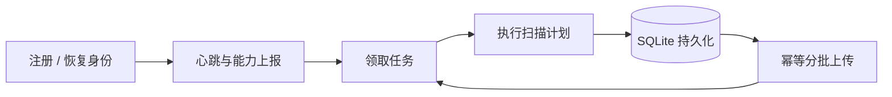

# Network Mapping Scanner

**Network Mapping 的分布式扫描节点**

负责注册认证、领取任务、执行扫描流水线并上传结构化结果。支持持久化恢复、租约续期、IPv4/IPv6 能力探测和远程日志诊断。

[快速开始](#快速开始) · [使用指南](docs/USAGE.md) · [维护参考](docs/MAINTENANCE.md) · [文档中心](docs/README.md)

## 扫描能力

| 阶段 | 引擎 | 输出 |
| --- | --- | --- |
| 端口发现 | masscan | 开放端口与协议 |
| 服务识别 | zgrab2 | 服务、Banner 与应用握手 |
| DNS 测绘 | DNS engine | 域名解析观察与记录 |
| 漏洞检测 | Nuclei | 经筛选的结构化漏洞结果 |

服务识别与漏洞扫描按本地配置启用，服务端根据节点上报的能力分配任务。仅 DNS 任务不启动 masscan、zgrab2 或 Nuclei。

## 工作流程



配套组件：[服务端](https://github.com/wshijiang/network-mapping) · [Web 控制台](https://github.com/wshijiang/network-mapping-vue)

## 快速开始

### 1. 准备环境

- Linux，Rust / Cargo（edition 2024）。
- 端口扫描节点安装 masscan，并具备发包所需权限。
- 服务识别节点安装 zgrab2；漏洞扫描节点另需 Nuclei 和经过审核的签名模板目录。
- 可访问已部署的 Network Mapping HTTPS 服务端。

### 2. 获取并编译

```sh
git clone https://github.com/wshijiang/Network-Mapping-Scanner.git
cd Network-Mapping-Scanner
cargo build --locked --release
```

### 3. 配置并注册

编辑 `config.toml` 中的 `scanner.c_server`、`scanner.c_port`、扫描速率和引擎参数。按节点容量选择速率，保留 TLS 校验；完整配置见[使用指南](docs/USAGE.md)。

在控制台创建扫描器，使用返回的 ID 和一次性注册令牌首次启动：

```sh
./target/release/scanner-rs --config config.toml \
  --id '<scanner-id>' --token '<registration-token>'
```

注册成功后身份写入本地 SQLite。后续启动无需再次传入注册令牌：

```sh
./target/release/scanner-rs --config config.toml
```

## 运行与维护

| 项目 | 默认行为 / 入口 |
| --- | --- |
| 身份与上传状态 | `./scanner-state.sqlite3`，可用 `--database` 指定 |
| 日志 | `./logs/scanner.log.YYYY-MM-DD`，UTC 按天轮转，保留最近 14 份 |
| 断线恢复 | 带抖动的指数退避；恢复心跳后继续领取任务和上传 |
| 远程配置 | 任务边界应用；本地禁用的引擎无法远程开启 |
| 远程诊断 | [错误与日志采集](docs/DIAGNOSTICS.md) |
| 清理待上传结果 | [缓存管理](docs/CACHE_MANAGEMENT.md) |

数据库包含运行令牌，应放在持久化本地磁盘并限制访问权限。清理结果前阅读缓存管理说明；任务租约失效时扫描会取消，过期结果不上传。

## 开发与验证

```sh
cargo fmt --check
cargo clippy --all-targets
cargo test
cargo build --locked --release
cargo run -- --help
```

联调需要服务端和相应扫描引擎。扫描目标必须处于明确授权范围内；提交问题时附引擎版本、复现步骤与脱敏日志。

## 文档导航

| 我想了解 | 阅读入口 |
| --- | --- |
| 服务识别、配置与双栈探测 | [使用指南](docs/USAGE.md) |
| 模块、CLI 和参数定义 | [维护参考](docs/MAINTENANCE.md) |
| 模板治理、恢复与诊断 | [文档中心](docs/README.md) |

## 许可证

本项目采用 [MIT License](LICENSE)。扫描引擎与模板遵循各自许可证。

## Docker 构建与部署

支持 AMD64/ARM64 镜像自动构建，分支与 PR 验证不发布，正式版本经具体授权后推送 GHCR。
镜像内容、配置、持久化、GitHub 设置及验收见 [Docker 部署指南](docs/DOCKER.md)。
