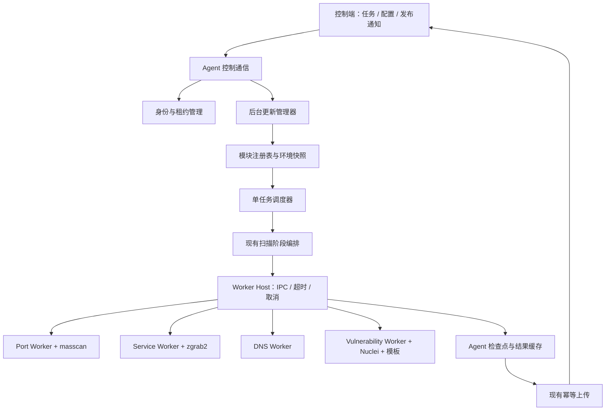

# 扫描端模块化与热更新详细设计

状态：架构设计与后续演进规划。扫描端现已实现独立 Worker、签名目录制品、任务版本绑定、在线激活、回滚与 HTTPS feed，实际接口和限制见 [操作指南](MODULE_UPDATES.md)。本文的 Unix Socket、控制端专用 API、前端发布管理、完整 Cargo workspace 拆分及 Agent supervisor 仍为后续规划；当前 IPC 使用继承的标准输入输出管道。

代码基线：

- 扫描端：`scanner-rs 0.1.18`，commit `29712828c9f2edce0ba361388620b0ae9f1caa08`。
- 配套服务端：commit `39f8b71d74150eb28cc8ce70cd7f00798ccff9f3`。
- 运行平台：现有 Linux、Rust edition 2024、Tokio；现有发布目标为 Linux x86_64 GNU，发布流水线检查 glibc 不高于 2.36。

## 1. 设计结论与更新边界

采用 **常驻 Agent + 独立扫描 Worker + 不可变发布包 + 任务级版本绑定**。

Agent 继续负责注册、身份、任务领取与恢复、租约、持久化、上传、网络能力和远程诊断。Worker 负责引擎调用、探测策略及结果解析，按独立进程协议接收任务。更新管理器在后台准备新版本，通过切换完整运行环境快照，让后续任务使用新版本。

首版保留一个活动任务的调度模型。新旧 Worker 可以同时存在，但新旧扫描任务不必同时运行；候选版本仅做预检，当前任务完成后，下一个任务绑定新版本。这符合现有存储、租约与上传模型，也避免更新造成扫描速率翻倍。

| 更新对象 | 生效边界 | 当前任务 | 是否重启 Agent |
| --- | --- | --- | --- |
| 运行参数 | 任务绑定环境时 | 保持原参数 | 否 |
| Nuclei 模板包 | 任务绑定环境时 | 固定原模板目录 | 否 |
| masscan/zgrab2/Nuclei 二进制 | 任务绑定环境时 | 固定原绝对路径 | 否 |
| 引擎适配、解析与探测策略 | 任务绑定环境时 | 固定原 Worker 版本 | 否 |
| DNS 查询实现 | DNS Worker 独立发布后 | 固定原 Worker 版本 | 否 |
| Agent 身份、租约、上传、存储逻辑 | Agent 升级窗口 | 优先排空，再受控交接 | 是 |
| Worker 协议、结果类型或扫描阶段的不兼容变更 | 协议协商与配套版本升级 | 使用旧协议完成 | 可能 |

Rust 普通动态库不提供可依赖的稳定 Rust ABI。独立进程协议可隔离编译器、依赖和 panic，并适配现有外部命令调用方式。首版采用本地进程与 Unix Domain Socket，无需引入 Kubernetes 或远程微服务。

## 2. 当前代码事实及其影响

| 代码位置 | 当前事实 | 设计影响 |
| --- | --- | --- |
| [`main.rs`](../src/main.rs) 的 `run`、`spawn_heartbeat`、`scan_loop`、`flush_with_guards` | 入口约 2669 行，包含启动、连接、租约、任务恢复、扫描、上传与维护逻辑 | 先拆职责，保留现有行为，再逐步替换执行边界 |
| [`scan/orchestrator.rs`](../src/scan/orchestrator.rs) | `run_scan` 直接调用四个引擎；控制阶段顺序、required 和取消 | 保留在 Agent，直接函数调用改为模块注册表派发 |
| [`scan/plan.rs`](../src/scan/plan.rs) | plan version 为 1，阶段和 profile 均为显式白名单 | 首版插件实现现有阶段；新增阶段需要升级计划协议和服务端校验 |
| [`scan/engines/masscan.rs`](../src/scan/engines/masscan.rs) | `Command::new(path)` 执行外部程序，解析端口结果 | 二进制路径可版本化；解析器随 Worker 发布 |
| [`scan/engines/zgrab2.rs`](../src/scan/engines/zgrab2.rs) 与 [`scan/detection.rs`](../src/scan/detection.rs) | 外部 zgrab2，内置初始/回退探测和结果归一化；服务识别分块保存检查点 | 这两个文件一起迁入 service Worker；块提交由 Agent ACK |
| [`scan/engines/dns.rs`](../src/scan/engines/dns.rs) | 通过 hickory-resolver 在扫描端进程内执行 | 仅升级外部扫描二进制不能更新 DNS 实现；需要独立 Worker |
| [`scan/engines/nuclei.rs`](../src/scan/engines/nuclei.rs) 与 [`nuclei_selection.rs`](../src/scan/engines/nuclei_selection.rs) | 外部 Nuclei，模板路径、服务标签和端口回退逻辑在代码内；执行时禁用 unsigned templates 与 update check | 模板、二进制、筛选与解析器组成兼容发布组合；维持现有模板约束 |
| [`runtime_config.rs`](../src/runtime_config.rs) | `stage` 暂存，`apply_pending` 在任务循环边界应用；远程配置受本地启用开关与速率上限约束 | 复用接收/校验模型，将配置与模块版本放进同一运行环境快照 |
| [`heartbeat.rs`](../src/heartbeat.rs) | 心跳上报主程序版本和启动时构建的 `ScanCapabilities`；`ActiveTask` 维护一个任务及租约 | 改为动态能力快照；租约仍由唯一 Agent 管理 |
| [`storage.rs`](../src/storage.rs) | schema 3；`StateStore::open` 获取状态库独占锁，拒绝更高 schema | 两套完整 Agent 不能同时打开同一状态库；Agent 回滚必须核对 DB 可读性 |
| [`journal.rs`](../src/journal.rs) 与 `main.rs` 的 `scan_key` | 用任务、参数、计划、配置与解析器的 Debug 文本构造键 | 需要加入实际发布包/模板摘要，改用稳定序列化计算签名 |
| [`cache.rs`](../src/cache.rs)、[`upload.rs`](../src/upload.rs) | 上传协议 3，批次最多 500 条/8 MiB，稳定 `upload_id` 与批序号 | 更新不能重新解释或重组已经进入上传队列的结果 |
| [`diagnostics/mod.rs`](../src/diagnostics/mod.rs) | 独立诊断 Worker，日志传输不阻塞租约心跳 | 更新下载、验签、预检也必须独立于心跳循环 |
| [发布流水线](../.github/workflows/release.yml) | 发布完整 scanner-rs 压缩包和 SHA256，未包含模块发布清单签名 | 扩展为独立模块构建、签名与发布目录 |

服务端相关事实：[`handlers/task.rs`](https://github.com/wshijiang/network-mapping/blob/39f8b71d74150eb28cc8ce70cd7f00798ccff9f3/src/handlers/task.rs) 的心跳模型及 `ScannerScanCapabilities::validate` 固定已知阶段/profile；[`scanner_config.rs`](https://github.com/wshijiang/network-mapping/blob/39f8b71d74150eb28cc8ce70cd7f00798ccff9f3/src/scanner_config.rs) 维护独立配置 revision；[`lib.rs`](https://github.com/wshijiang/network-mapping/blob/39f8b71d74150eb28cc8ce70cd7f00798ccff9f3/src/lib.rs) 的任务领取 SQL 使用 `accepting_tasks` 与扫描能力过滤，结果上传检查批次内容冲突。这些都是需要保留的协议约束。

## 3. 目标架构与代码目录



拟议 Cargo workspace：

```text
crates/
  scanner-protocol/           # IPC、配置 DTO、观察数据、错误码与版本定义
  scanner-agent/              # 对外保留 scanner-rs 命令名
    src/
      main.rs                # CLI 与组装
      app.rs                 # 启动/关闭
      control/               # 注册、HTTP、心跳、网络、重连
      task/                  # 任务恢复、租约、调度、阶段编排
      results/               # cache、upload
      state/                 # StateStore、ScanJournal
      modules/               # registry、host、execution_environment
      update/                # 下载、验签、预检、激活、GC
      diagnostics/           # 现有诊断
  scanner-worker-sdk/         # IPC loop、取消、进度、资源预算与子进程封装
  scanner-port-worker/        # masscan 适配器
  scanner-service-worker/     # zgrab2 适配器 + detection
  scanner-dns-worker/         # DNS 实现
  scanner-vulnerability-worker/ # nuclei + selection
```

迁移时可以先在现有 `src/` 新增 `modules/`、`update/` 和 `task/`，等调用关系稳定再调整 Cargo workspace。不要同时改协议、调度并发与上传模型。

模块职责：

- `ModuleRegistry`：保存可用版本、候选版本、当前完整 generation、任务引用；提供原子读取和提交。
- `WorkerHost`：启动指定版本、验证握手、发送输入、处理事件、取消及回收进程树。
- `UpdateManager`：后台下载和校验，管理发布事务；不直接领取任务，也不修改已有任务快照。
- `TaskExecutor`：保留 profile/required/取消策略；选择 Worker、保存检查点、汇总结果。
- `StateWriter`：唯一持久化入口；Worker 无 SQLite 访问权。初版可以由现有调度线程写入，涉及共享访问时再改为有界队列的存储 actor，避免把 rusqlite 连接直接跨任务共享。

## 4. 发布包、注册表与运行环境快照

### 4.1 模块包

模块包是可独立构建的发布单元。一个逻辑模块可以引用多个不可变内容包，例如 service Worker 引用指定 zgrab2 包，vulnerability Worker 引用指定 Nuclei 包和模板包。发布清单锁定这些内容的精确摘要，不能仅依赖可变化的系统 PATH。

```json
{
  "manifest_schema": 1,
  "module_id": "service-detection",
  "module_version": "1.2.0",
  "artifact_sha256": "<64位十六进制摘要>",
  "target": "x86_64-unknown-linux-gnu",
  "glibc_min": "2.36",
  "entrypoint": "bin/scanner-service-worker",
  "ipc_versions": [1],
  "stage": "service_detection",
  "config_schemas": [1],
  "observation_schemas": [1],
  "checkpoint_schema": 1,
  "agent_version_requirement": ">=0.2.0,<0.3.0",
  "dependencies": {
    "zgrab2": {"artifact_sha256": "<指定二进制包摘要>"}
  }
}
```

签名封装在独立的 `manifest.sig` 中，包含 `key_id` 和签名；签名对象为发布时固定的原始 manifest 字节。包摘要覆盖归档内容。内部文件列表及摘要置于归档清单中，避免给“包含自身摘要的 manifest”建立循环依赖。`0.2.0` 为示例新基座版本，最终范围由实现后的兼容矩阵确定。

候选 Worker 的 Hello 描述必须与已签名清单一致。包入口限制为包目录内的相对常规文件，依赖版本解析仅在预检时发生，任务执行时使用已经锁定的绝对路径。

### 4.2 扫描端目录

```text
/opt/network-mapping-scanner/
  agent-releases/<version>/scanner-rs
  modules/<module-id>/<artifact-sha256>/...
  templates/<artifact-sha256>/...
  staging/<deployment-id>/...
/var/lib/network-mapping-scanner/
  scanner-state.sqlite3       # 现有身份、检查点、上传与失败计数
  module-state.sqlite3        # 发布事务、环境快照、任务版本绑定
  update.lock
/etc/network-mapping-scanner/
  config.toml
  trusted-update-keys.json
/run/network-mapping-scanner/
  workers/<instance-id>.sock
```

两个状态库由同一 Agent 管理并各自使用独占锁；module-state 的写入通过 Agent 内部存储入口串行化。Worker 不接触这两个数据库。更新包完成后目录只读；运行时临时文件存放在独立工作目录。文件/目录所有权应阻止 Worker 修改发布包、可信公钥和 Agent 程序。

### 4.3 ExecutionEnvironment

任务启动时绑定完整快照：

```text
ExecutionEnvironment
  generation                 # 本地单调递增编号
  release_id                 # 控制端批准的发布组合
  config_revision
  effective_config           # 已应用本地限制的实际参数
  modules                    # module_id -> 精确摘要/IPC/绝对入口路径
  engine_artifacts           # 外部引擎摘要与绝对路径
  template_artifact          # 模板摘要与绝对路径
  plan_schema / observation_schema / checkpoint_schema
```

`RuntimeConfiguration` 的待生效配置和模块发布必须经同一个环境协调器提交。兼容配置单独变化也生成新的 generation。任务读取一次 `Arc<ExecutionEnvironment>`，所有阶段和重试均使用这个快照。

注册表可先用 `Arc<RwLock<Arc<ExecutionEnvironment>>>`，写锁内只替换指针；下载、启动、验签和数据库 I/O 均在锁外完成。最终提交由环境协调器串行执行：检查预检依据的旧 generation，若已经变化则重新校验兼容性；持久化新快照与激活记录成功后，再替换内存指针。提交期间暂停新任务绑定，持久化失败则继续使用旧环境。

任务绑定的 gate 从选取环境持续到绑定记录落盘，防止 GC 在这段时间删除其版本。只在 durable pin 成功后允许 Worker 执行。旧任务可以继续持有旧环境；回滚也创建新 generation，不能重用旧 generation 编号。

## 5. Worker 协议与执行接口

### 5.1 传输和握手

使用 Unix Domain Socket，长度前缀帧：4 字节大端长度 + UTF-8 JSON。运行目录仅允许本地服务账号访问，Agent 校验 peer credentials 与其启动的 Worker PID；连接名不作为身份凭据。socket 由父进程创建并交给子进程，首帧携带一次性随机握手 nonce，防止旧连接误接。

建议首版每帧最多 8 MiB，读取时先检查长度，再分配内存；单条观察数据继续受对应引擎的更小限制约束。使用有界事件队列（初始建议 32 帧），超出容量时背压，限制同时序列化的缓冲数。输入端口列表也按帧流式发送，避免大任务只能塞入一个 Execute 帧。

正常数据走 socket，日志走 stderr。首版无需把所有输入放进临时文件；未来若增加文件传输，须增加路径、所有权与摘要校验契约。

### 5.2 消息定义

| 方向 | 消息 | 必需字段 / 语义 |
| --- | --- | --- |
| Worker → Agent | `Hello` | module_id、版本/构建摘要、IPC 支持版本、stage、schema、nonce |
| Agent → Worker | `HelloAck` | 选定 IPC 版本、instance_id、资源限制；握手未完成不能执行 |
| Agent → Worker | `SelfTest` | 固定测试用例标识，禁止扫描生产目标 |
| Worker → Agent | `SelfTestResult` | 解析/依赖检查结果，结构化错误码 |
| Agent → Worker | `Execute` | request_id、task_id、stage_index、环境摘要、目标、有效配置、恢复 cursor、剩余预算 |
| Agent → Worker | `InputChunk` / `InputEnd` | 序号、端口/服务等阶段输入，结束标记及整体摘要 |
| Worker → Agent | `BlockStarted` | chunk、已耗时；Agent 持久化 running 标记后 ACK 才允许执行该块 |
| Worker → Agent | `ObservationChunk` | event_seq、chunk_id、结构化 observation；仍是暂存数据 |
| Worker → Agent | `BlockCompleted` | chunk_id、next_cursor、块摘要、累计耗时；完整校验落盘后 ACK |
| Worker → Agent | `Progress` | 引擎 PID、输入/输出计数、已耗时、无输出时间；不等同于检查点提交 |
| Worker → Agent | `StageFinished` | outcome = completed/partial/cancelled/failed、错误码、结果摘要 |
| Agent → Worker | `Cancel` | task_id、request_id、原因与终止期限；控制消息有独立发送优先级 |
| Agent → Worker | `Drain` | 不再接受新 Execute，已有请求继续完成 |
| Agent → Worker | `Shutdown` | 安全关闭；超时后 Agent 回收进程树 |

每条运行消息包含 request_id；Agent 检查实例、任务、stage 和顺序，忽略旧实例/已结束请求的事件。Worker 返回结构化错误对象，不把现有 `ScannerError` Rust 内存布局放到协议里。

### 5.3 不完全结果与检查点

`ObservationChunk` 收到后先写 Agent 临时块缓冲，达到容量上限则停止阶段并明确失败或 partial。收到 `BlockCompleted` 后，Agent 校验输入/输出摘要与 cursor，在同一状态库事务内保存块结果和下一 cursor。ACK 仅在事务提交后发送。已提交块重传时按 request/chunk identity 校验内容，相同则重复 ACK，内容冲突则拒绝。

进程崩溃只重做未 ACK 的块。masscan、DNS、Nuclei 首版保持现有“阶段完成提交”的恢复粒度，分帧传输不意味着这些引擎已经具备块恢复能力。service Worker 保留现有 zgrab2 分块恢复。

service 适配器返回 partial 时，未完整提交的最后一块可以作为当次可选阶段的临时结果；Agent 确认采用 partial 并提交整个阶段后，这些结果才成为持久成功结果。required 阶段遇到 partial 必须失败，不能跳到完整成功。保持现有 `legacy` profile 对本地 `service_detection.required` 的使用规则。

Agent 将 `StageFinished` 转成统一 `StageOutcome`：Completed、Partial、Cancelled、Failed。模块可以独立实现新解析逻辑，但输出仍需符合 `ScanObservation` 的现有四类类型和字段约束。

### 5.4 取消、预算与资源

- Agent 继续运行 `ActiveTask` 租约监控；租约丢失/服务端取消优先于更新操作。
- Worker 使用独立 Tokio reader 接收 Cancel，不能因执行扫描或等待输出阻塞控制帧处理。
- 每次启动 Worker 建立独立进程组；正常取消先通知 Worker，再在截止时间内结束 Worker 和引擎后代并 wait。可使用 systemd/cgroup 管理进程树，避免只杀 Worker 留下 masscan。
- 总运行时间和 idle timeout 由 Worker 执行，Agent 再加外层硬截止时间，防止损坏的 Worker 忽略限制。
- 服务识别恢复预算继续跨重启累计，保持现有 running 标记保守计入停机时间及三次失败上限。
- 当前 zgrab2 原始输出/阶段聚合 64 MiB、单行 8 MiB 等约束应保持；其他阶段新增总结果限制须单独定义并回归验证，不能静默截断结果。
- IPC 分帧减少传输峰值，但现有整体 `Vec<ScanObservation>` 仍占内存。进一步改成数据库流式结果读取属于后续独立改造。
- masscan 权限在受控启动入口授予，具体 capabilities 以部署验证为准；其他 Worker 用普通账号。更新模块不能决定任意命令、提升权限或注入未经校验的 argv。
- 预热 Worker 不开始网络扫描。运行阶段只有现有活动任务消耗网络预算；未来增加任务并发时还需跨 Worker 的统一节点限速。

## 6. 持久化、检查点签名与恢复

### 6.1 新增模块状态库

首版增加独立 `module-state.sqlite3`，保留 scanner-state 的 schema 3，减少模块升级与主状态库迁移耦合。建议表：

| 表 | 主键/关键字段 | 用途 |
| --- | --- | --- |
| `artifact` | artifact_sha256；module_id、版本、路径、校验状态、manifest | 内容寻址包库存 |
| `environment` | generation；release_id、完整有效快照、快照摘要、created_at | 不可变运行环境 |
| `active_environment` | scope；generation | 当前环境指针，scope 包含规范化 server_origin |
| `deployment` | deployment_id；desired_revision、source/target generation、状态、错误、时间 | 更新事务及重启恢复 |
| `task_environment` | server_origin + task_id；generation、计划/解析器/配置快照、执行标识、状态 | 重启后恢复任务使用的版本 |
| `artifact_pin` | artifact_sha256 + owner_type + owner_id | task、candidate、rollback 等持久引用 |

环境、激活指针、deployment 状态写入同一个模块状态库事务。任务记录保存实际参数和计划，不能只存 revision，因为控制端配置可能已更新。task_id 采用当前代码语义；同一任务被重新执行时还要比较参数、计划摘要。配套协议将来暴露 execution_id 后应优先用 execution_id 区分执行实例。

### 6.2 两个数据库之间的恢复顺序

两个 SQLite 文件不宣称具备跨库原子事务。通过明确写入顺序和重启对账保证恢复：

1. 领取/确认服务端执行，选定运行环境。
2. 持久化 task_environment 及 artifact_pin。
3. 在现有 scanner-state 保存/开启检查点。
4. 启动对应 Worker。
5. 扫描完成，先按现有 `begin_task_with_observations` 持久化结果，再清除扫描检查点。
6. 上传完成或服务端终态已确认后，释放任务 pin，保留审计记录。

步骤 2 后崩溃但尚无检查点/上传缓存：保留 pin，先询问服务端；不能直接删除，避免丢失已被领取任务的版本绑定。步骤 5 的两个写入之间崩溃：优先处理 pending_upload，禁止再执行扫描。释放 pin 的条件应包含“无可恢复扫描状态、无待上传状态、服务端执行终态已确认或已按现有机制归档”，不能仅根据 Worker 已退出。

已有 pending_upload 即使缺少模块状态记录，也继续按照原有协议上传；它不依赖重新加载扫描模块。已有检查点缺少 task_environment 时，不自动沿用新包继续：保留旧记录，确认任务所有权后按明确策略重新扫描或人工处理。

### 6.3 scan_key 改造

当前 `scan_key` 使用 `format!(...{:?}...)`，实际内容摘要未进入键。新 key 计算输入应包括：

- task_id、目标、端口、地址族、实际速率；
- plan 和显式 DNS resolvers；
- 完整有效配置；
- Worker/引擎/模板内容摘要；
- 结果 schema、checkpoint schema 及扫描环境编码版本。

采用显式 DTO、固定字段顺序和规范化集合的序列化，再计算 SHA256。集合排序仅适用于语义无顺序的字段，不能重排扫描阶段。

首版格式建议 `task_id|v2|sha256`，保留 task_id 前缀。**不能直接改成纯 SHA256**：现有 `StateStore::load_checkpoint` 会通过 `key.split('|').next()` 取 task_id 增加失败计数。应同时重构为显式传入 task_id；兼容期保留前缀。

新旧 key 不会相等，需要安排一次受控检查点转换：升级前排空，或保留旧 checkpoint 并重新扫描。后续模块更新中，恢复任务先加载 task_environment，再计算同一版本环境的 key，不使用当下最新配置或发布包。

当前循环开头会 `apply_runtime_configuration`，之后才恢复扫描任务。重构后区分“新任务环境”和“已绑定恢复任务环境”：前者采用最新已提交配置，后者继续使用持久化配置。不能让远程配置更新悄悄改变恢复任务的签名。

### 6.4 上传内容保持稳定

Worker 只生成 observation，由 Agent 使用现有身份和租约上传。保持上传协议 3、500 条/8 MiB 上限、upload_id、批索引、观察顺序和原 payload。更新后不重新解析待上传 JSON，不重新去重，也不按新模块逻辑重新生成已发送批次。

第一阶段不向现有上传 payload 添加模块版本字段，版本信息放在本地任务审计和新增能力协议里。将来需要服务端保存来源版本时增加明确的元数据接口或协商协议，并纳入批次一致性设计。

## 7. 更新事务、回滚与版本回收

### 7.1 更新状态机

```text
announced -> downloading -> verified -> prepared -> preflight_passed
          -> committed -> observing -> healthy
失败（提交前） -> rejected
失败（提交后） -> rollback_preparing -> rolled_back
```

`committed` 表示后续新任务的环境已切换，不表示整个节点所有任务均已使用新版本。控制台同时展示当前 generation、活动任务 generation 与 pending release。

详细步骤：

1. 心跳收到发布通知，只放入有界更新队列并立即返回；重复 deployment_id 幂等处理。
2. UpdateManager 获取更新锁，检查节点授权、平台、接口、schema、本地引擎开关和空间。一个节点同一时间只提交一个更新事务。
3. 限速下载到 staging；支持续传时校验 ETag/版本和最终完整摘要，内容变化则重下。
4. 检查签名、制品摘要和发布 revision。解包时拒绝绝对路径、`..`、符号/硬链接、设备文件及超出解包大小/文件数上限的包。
5. 写入文件并 fsync，原子 rename 到内容寻址版本目录，再 fsync 父目录；不覆盖旧版本目录。
6. 启动候选 Worker，完成 Hello、依赖版本检查、固定输出解析测试、模板治理检查及资源检查。首版不拿生产目标做影子重复扫描。
7. 构建完整候选环境，锁定所有依赖和配置，预检不支持则拒绝发布。
8. 在新任务绑定 gate 内提交模块状态库事务，然后替换内存环境指针。正在执行的任务及恢复任务不切版本。
9. 上报已提交状态，按固定观察窗口统计新版本执行的有效样本；通过后标为 healthy，保留回滚候选。
10. GC 根据持久引用清理不可达版本，启动后先恢复 deployment 和 pins 再运行 GC。

若节点在事务提交后、内存替换前崩溃，重启以数据库 active_environment 为准恢复；若提交前崩溃，旧环境仍有效，staging 可重检或清理。

### 7.2 自动回滚条件

发布前确定阈值，避免把网络变化或目标无响应误判为程序回归。初始建议：

- IPC 不兼容、Worker 启动失败、输出 schema 不合法：立即停止向候选版本分配新任务，并回滚。
- 连续 3 个非目标因素的 Worker 崩溃或资源超限：触发回滚；不把正常服务端取消、租约丢失和目标超时计入同一指标。
- 成功率/延迟回归：仅比较相同 profile 和配置下的可比较样本。建议至少 20 个新版本任务再作统计判断，具体阈值依据现网基线制定。
- 未达到最小样本的节点保持 observing；长时间无任务可以由运维结束观察，不能自动声称通过运行验证。

回滚操作选择已验证的历史环境，重新检查其本地包、当前协议和本地策略仍可用，再以更大的 generation/revision 提交。运行中任务默认继续原版本；若存在严重执行故障，由任务故障策略终止，恢复时维持原 pin，或明确放弃旧检查点后用回滚环境重做，不能混用阶段结果。

普通防降级检查不允许旧的网络通知激活历史包。经过授权的回滚由新的、单调递增发布指令引用历史摘要；历史发布版本可以低，但发布指令 revision 必须新。

### 7.3 旧版本回收

版本目录的删除依据持久可达性：当前环境、回滚保留环境、候选发布、未完成任务和检查点的引用。引用计数不能仅用内存 `Arc::strong_count`，进程重启后内存引用已消失但任务仍需恢复。

首版建议保存最近两个成功环境及所有活动引用；空间不足时停止下载/更新并告警，继续当前扫描，不删除仍被引用的包来腾空间。模板目录与二进制目录执行相同策略。

## 8. 配套控制端与前端改造

### 8.1 心跳增量协议

继续使用 `/api/scanner/heartbeat`。建议新增带默认值字段：

```json
{
  "module_state": {
    "protocol_versions": [1],
    "active_generation": 42,
    "active_release_id": "release-2026-10-12-01",
    "task_generation": 41,
    "modules": [
      {"id": "service-detection", "version": "1.2.0", "sha256": "<digest>", "ready": true}
    ],
    "update": {"deployment_id": "<uuid>", "status": "observing", "error_code": null}
  }
}
```

响应新增可选 `module_update_notice`，包括 protocol_version、deployment_id、desired_revision 和 manifest_sha256；大清单通过独立端点获取。Worker 的 module_state 不写入现有 `scan_capabilities` 对象内部，避免混淆旧协议。

`HeartbeatClient` 现有 `scan_capabilities: ScanCapabilities` 改为可读共享快照，从**当前新任务可用环境**生成 profile/stages；本地 disabled、预检未通过或熔断的模块不能上报 ready。部分 profile 有可选阶段，例如 vulnerability_scan 的 service_detection 为可选，要按现有计划语义计算 readiness。

服务端当前领取 SQL 对 `legacy` 使用 `t.scan_profile = 'legacy' OR ...`，会绕过 profile 能力检查。新模块节点必须增加显式 legacy readiness 判断，至少确认 port_discovery 可用；旧节点保持兼容默认值。仅从 profiles 中移除 legacy 不能解决这一问题。对于能力集合发生变化的更新，Agent 在本地暂缓新任务领取，直到一次成功心跳确认新能力已保存；恢复已有运行执行继续按原任务 pin 处理。领取后仍按绑定环境复查 required 阶段，避免心跳和领取之间的状态变化。

现有 `accepting_tasks` 来自 diagnostic_health，不能让更新模块与诊断模块互相覆盖。新增 AdmissionController 汇总诊断、启动、维护、更新交接等 blocking reasons，最终计算一个值。后台普通模块准备通常无需暂停领取；Agent 交接或无可执行环境时才停止新任务。

节点状态仍使用服务端已接受的 idle/scanning/stopping，更新状态放在新字段，避免给旧心跳 state 增加未知字符串。

### 8.2 新增 API 与权限

以下路径为拟议接口，不是现有功能：

| 接口 | 调用方 | 作用 |
| --- | --- | --- |
| `GET /api/scanner/modules/desired?scannerid=...` | 扫描端 Bearer 身份 | 返回该节点批准的完整发布组合 |
| `GET /api/scanner/modules/artifacts/{sha256}` | 扫描端或制品存储 | 下载批准制品；校验是否允许该节点使用 |
| `POST /api/scanner/modules/deployments/{id}/events` | 扫描端 | 幂等报告更新事件，重复事件用 event_seq 去重 |
| `POST /api/scanner/{id}/module-deployments` | 已授权管理员 | 创建发布，携带 expected_revision、完整组合和原因 |
| `POST /api/scanner/{id}/module-deployments/{deployment}/rollback` | 已授权管理员 | 创建指向历史组合的新发布 revision |
| `GET /api/scanner/{id}/module-deployments` | 管理员 | 查看当前状态与历史 |

服务端新增发布目录、节点 desired/observed revision、deployment 及事件记录；管理员写操作复用现有鉴权、CSRF 和审计。expected_revision 提供乐观并发控制，冲突返回 409；同一个幂等键不重复创建发布。

`ServerHttpClient::get` 目前统一附加 runtime_token，不能用它向任意外部制品 URL 下载，以免发送节点凭据。制品同源端点可复用认证；外部对象存储使用独立、无节点 Bearer 的客户端或短时下载 URL，限制重定向与来源范围，并始终校验签名及摘要。

### 8.3 兼容与灰度

先发布控制端：新字段 `#[serde(default)]`，只有节点声明模块协议能力时才通知更新。新 Agent 连接旧服务端时走本地注册表模式，不自动执行远程更新；旧 Agent 连接新服务端继续现有流程。

首版支持替换已有四类 stage 的实现。任意新增阶段/profile 必须同时修改服务端 `ScannerScanCapabilities::validate`、调度过滤、扫描端 `ScanPlan::validate`、结果协议和前端任务创建，完成显式版本协商。

灰度以节点为单位，先专用测试节点，再少量同平台节点，再扩大范围。节点任务量少，按节点数量灰度不等于运行样本充足，应同时观察真实执行样本数。

前端 [`ScannerDetail.vue`](https://github.com/wshijiang/network-mapping-vue/blob/main/src/views/ScannerDetail.vue) 新增模块列表、目标/当前发布、任务版本、状态与错误、回滚操作。`ScannerConfiguration.vue` 继续管理参数；发布版本单独管理，操作前展示兼容预检结果和受影响模块。

## 9. Agent 自身升级与数据库回滚限制

Worker 热更新保证 Agent 常驻，租约和心跳持续。Agent 自身升级采用独立 supervisor 或 systemd 受控重启：

1. 新 Agent 仅做 `--preflight`，不能调用现有 `StateStore::open` 打开活动库；可用专用只读检查或 SQLite 安全备份副本检查兼容性，不领取任务、不注册身份、不发送常规心跳。
2. 旧 Agent 设置停止接新任务，但继续恢复/完成已有扫描和上传、续租与诊断。
3. 待当前任务完成后退出，释放数据库独占锁和工作进程。
4. supervisor 启动新版本；等待数据库打开、连接/诊断初始化完成和首次成功心跳，区分“进程存活”与“已准备接任务”。
5. 超时/启动失败，只有旧 Agent 能读取当前数据库和模块状态时才自动切回旧版本。

断网导致任务无法排空时，默认延期 Agent 升级并上报阻塞原因。计划内强制交接需要单独策略：保存状态、取消进程、释放锁，新版本按现有服务端任务恢复机制确认所有权后继续；该方式会有停顿，并可能重做未提交扫描阶段，不能承诺无损零停顿。

当前 schema 3 的程序会拒绝更高 user_version。因此只做“先备份 DB，再升级，再失败时恢复备份”并不足以支持无损回滚：新程序运行后的身份变化、上传 ACK 和任务进度可能已经改变，恢复陈旧备份会让本地状态倒退。

本方案的模块状态独立存储，使正常 Worker 升级不迁移主状态库。未来 Agent schema 升级应优先保证上一版本可读，或安排停机迁移并禁止自动回滚。旧 0.1.18 不理解新模块快照/检查点语义，首次基座迁移应排空任务；不能因为主库仍为 schema 3 就宣称可以任意回退旧扫描端。

## 10. 配置与运维接口

拟议本地配置示例：

```toml
[modules]
directory = "/opt/network-mapping-scanner/modules"
state_database = "/var/lib/network-mapping-scanner/module-state.sqlite3"
allowed = ["port-discovery", "service-detection", "dns-lookup", "vulnerability-detection"]

[updates]
enabled = true
channel = "stable"
trusted_keys = "/etc/network-mapping-scanner/trusted-update-keys.json"
staging_directory = "/opt/network-mapping-scanner/staging"
max_download_bytes = 536870912
max_unpacked_bytes = 1073741824
max_archive_files = 100000
retain_successful_environments = 2
preflight_timeout_seconds = 30
cancel_grace_seconds = 5
```

以上容量和时限是初始建议，需按真实引擎包大小、模板数量及节点磁盘容量调整。保留现有 scanner/service_detection/dns/nuclei 配置兼容入口，迁移时把旧路径解析为受控的本地初始版本，并计算内容摘要；路径对应文件的修改权限应受限。

CLI 建议增加 `module list`、`module inspect`、`module verify`、`update status`、`update apply`、`update rollback` 和 `--preflight`。独立维护进程不能直接打开已锁定数据库：活动 Agent 通过本地管理 socket 执行；离线时才直接操作库，并获取同样的独占锁。沿用当前 `cache clear` 的身份保护和显式维护语义。

新增日志事件：ModuleUpdateAnnounced、ModuleVerified、ModulePreflightFailed、EnvironmentCommitted、TaskEnvironmentPinned、WorkerStarted、WorkerProtocolRejected、ModuleRollbackCompleted、ModuleGcBlocked。

事件包含 deployment_id、generation、task_id、module_id、artifact_sha256、stage、error_code、耗时和处理结果，禁止记录 runtime_token。诊断采集目前使用字段白名单，因此新增版本字段需同步更新诊断协议/白名单及服务端解析，不能只写 tracing 就期待远程可见。

## 11. 分阶段实施及文件级改造清单

| 阶段 | 具体改造 | 退出条件 |
| --- | --- | --- |
| P0：行为拆分 | 从 main.rs 提取 app、task loop、connection、upload coordinator；types.rs 拆配置/任务/结果 DTO；保留所有测试 | 现有行为与恢复测试通过，仍发布单个扫描端 |
| P1：版本化资源 | 新增 modules/registry、update/store/verify；绝对路径和模板内容摘要；完整环境快照与任务 pin；修订 scan_key | 外部引擎/模板可更新和回滚，恢复任务不混版本 |
| P2：Worker 边界 | 先迁移 service Worker 与 detection，替换 ScanJournal 直接访问为 ACK 事件；再迁移 DNS、Nuclei、masscan | 适配器代码可独立发布，IPC 故障与取消可控 |
| P3：远程发布 | 心跳动态能力、发布通知、后台下载队列；控制端 desired/observed、审计、灰度；前端版本视图 | 可从控制台发布并看到准确状态，旧版本兼容 |
| P4：Agent 运维 | supervisor、preflight、交接与受限回滚；发布签名与兼容矩阵自动验证 | 节点可受控升级，数据库不兼容时明确阻止自动回滚 |

P1 阶段 Rust 解析器和 DNS 实现仍随 Agent 发布，完成 P2 才具备这些模块的代码热更新。各阶段交付必须按这个边界描述，避免把“换二进制/模板”误报为“所有模块均可热更新”。

关键文件变更：

- `main.rs`：启动组装；TaskExecutor 使用 pin，恢复优先于最新环境；不再直接掌握模块路径。
- `scan/orchestrator.rs`：保留流水线策略，注入 Registry/Host；直接引擎调用替换成阶段执行接口。
- `scan/plan.rs`：从环境生成动态能力，首版仍保持 plan v1 白名单。
- `scan/engines/zgrab2.rs`、`scan/detection.rs`：迁移到 service Worker；跨进程保存块改为提交事件和 ACK。
- `scan/engines/nuclei.rs`、`nuclei_selection.rs`：迁移到 vulnerability Worker；固定模板目录，保持现有安全参数和筛选范围。
- `scan/engines/dns.rs`：迁移到 DNS Worker；显式 resolver 元数据和解析结果格式保持一致。
- `scan/engines/masscan.rs`：迁移到 port Worker；统一进程组取消、权限和输出容量约束。
- `runtime_config.rs`：继续负责远程参数校验，与环境协调器共同提交；恢复任务使用旧的有效配置。
- `journal.rs`、`storage.rs`：显式 task_id、稳定环境签名、块 ACK，保持累计时间与失败上限。
- `heartbeat.rs`：读取共享能力；新增发布通知/状态；仅入队，不在心跳链路下载更新。
- `cache.rs`、`upload.rs`：保留现有幂等载荷和恢复策略，新增审计关联而非改变待上传数据。
- `diagnostics/*`：汇总 admission reasons，增加模块状态和协议错误的受控字段。
- `.github/workflows/release.yml`：按模块构建、打包、兼容检查、签名；按内容摘要发布，制品不原地替换。

## 12. 验收矩阵

使用现有假扫描进程、本地 HTTP 与临时 SQLite 模式；验收无需扫描真实网络。

| 用例 | 预期结果 |
| --- | --- |
| zgrab2 执行中更新 Worker/引擎/模板 | 当前任务所有阶段保持原环境，下个新任务使用新环境 |
| 原路径相同但文件摘要不同 | 新环境签名不同，不能复用旧检查点 |
| 远程配置更新后恢复旧任务 | 恢复持久绑定的实际配置，不用最新配置覆盖 |
| required 阶段返回 partial | 任务失败；可选服务阶段允许保留已确认的不完全结果 |
| Worker 完成块后、ACK 前被杀 | 根据落盘结果重复 ACK 或重做未提交块，无重复结果 |
| BlockStarted ACK 后断电 | 原有 running 标记累计时间和失败次数，重启不能重置预算 |
| active 指针落盘后、内存替换前崩溃 | 重启按持久 active_environment 恢复，无混合组合 |
| 包签名错误、路径穿越、超大解包、平台不匹配 | 激活前拒绝，旧任务继续运行 |
| 候选 Hello/schema/self-test 不通过 | 拒绝发布，动态能力不增加 |
| 下载中断、磁盘不足 | 更新暂停/失败，身份、任务和现有可用包保留 |
| 更新中租约丢失/收到取消 | 取消优先，所有扫描后代退出，保留现有恢复/归档策略 |
| 上传 ACK 丢失时更新 | 使用原 upload_id/batch_index/payload 重传；服务端幂等成功 |
| 新 Worker 崩溃后回滚 | 新任务回到历史环境，旧检查点不跨版本混用 |
| 更新与新任务绑定/GC 同时发生 | 已绑定版本落盘后才启动，所有 pin 保护的包均不删除 |
| 两次发布并发到达 | revision/generation 冲突可识别，不能交叉组合依赖 |
| 新 Agent 对新 schema 失败且旧 Agent 不兼容 | 禁止自动回滚和恢复陈旧备份，保留现场并报告 |
| 新旧服务端/扫描端四种组合 | 无模块协议能力时沿用原功能，支持时启用新增流程 |
| Worker 不读 socket / 输出无限制数据 | 有界缓冲、总预算、取消硬截止生效，Agent 心跳仍能运行 |

实现后检查 `cargo fmt --check`、`cargo clippy --all-targets --locked -- -D warnings`、`cargo test --locked`、`cargo build --locked --release`。新增协议黄金样本、兼容矩阵和断点故障注入测试；只验证完整流程的关键不变量，避免以模拟 happy path 代替恢复验证。

吞吐验收采用同一固定输入与假引擎比较拆分前后耗时、内存峰值和心跳延迟；实际性能阈值在基线测量后确定。Linux x86_64/glibc 兼容检查沿用现有发布流水线，并扩展到所有 Worker 及其打包依赖。

## 13. 实施前需要确认的产品约束

默认采用“模块更新不打断当前任务、单活动任务、Agent 升级可受控重启”。实施前还需确认：

1. 是否要求 Agent 自身升级也维持无间断心跳；若要求，需要另行拆分租约通信守护进程并设计本地所有权交接协议。
2. 最大任务持续时间及模块版本允许保留多久；影响旧版本磁盘预算与发布完成时间。
3. 现网 Linux 发行版、CPU 架构、systemd/cgroup 和 masscan 权限方式；当前自动发布仅覆盖 x86_64 GNU。
4. 是否允许扫描节点直连制品存储；默认可由控制端代理分发，并采用独立制品下载认证。
5. 模板发布审核和签名的归属；发布包签名与 Nuclei 模板签名是两层独立检查。

这些约束影响部署参数与 Agent 自身升级范围，不影响先完成模块接口、不可变环境和任务版本绑定。
